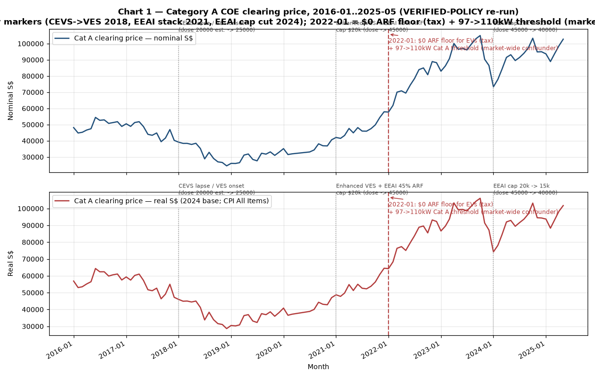
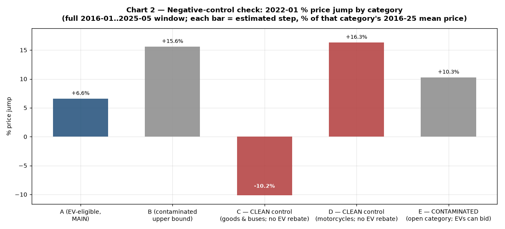
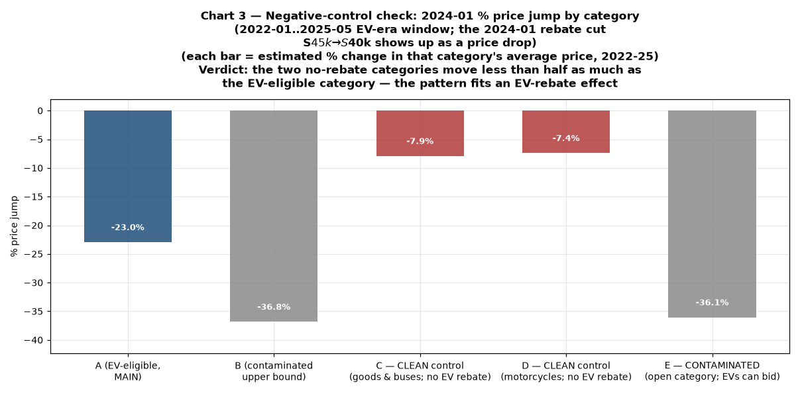
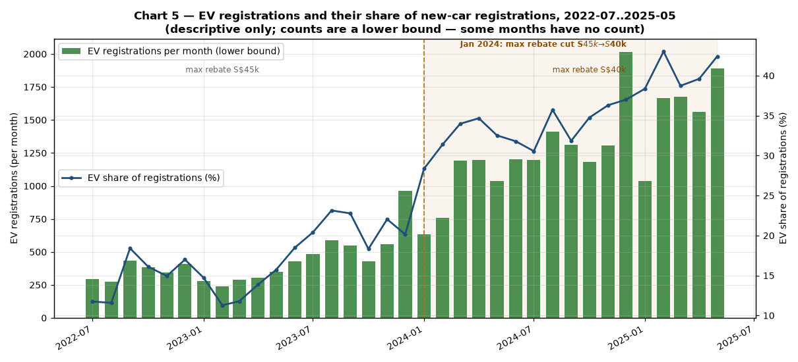
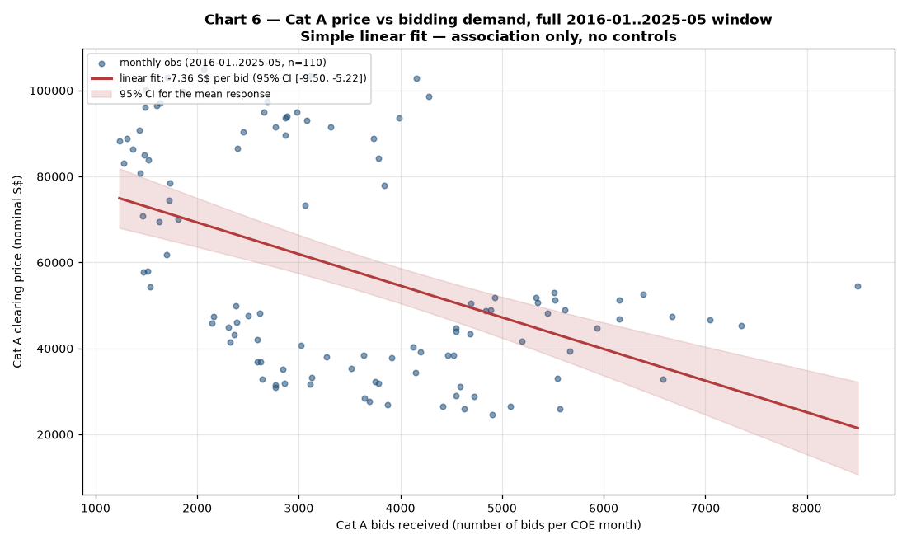
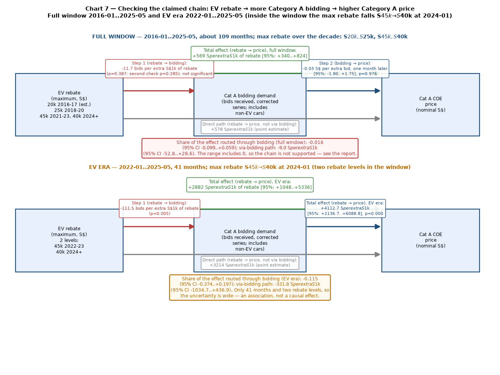
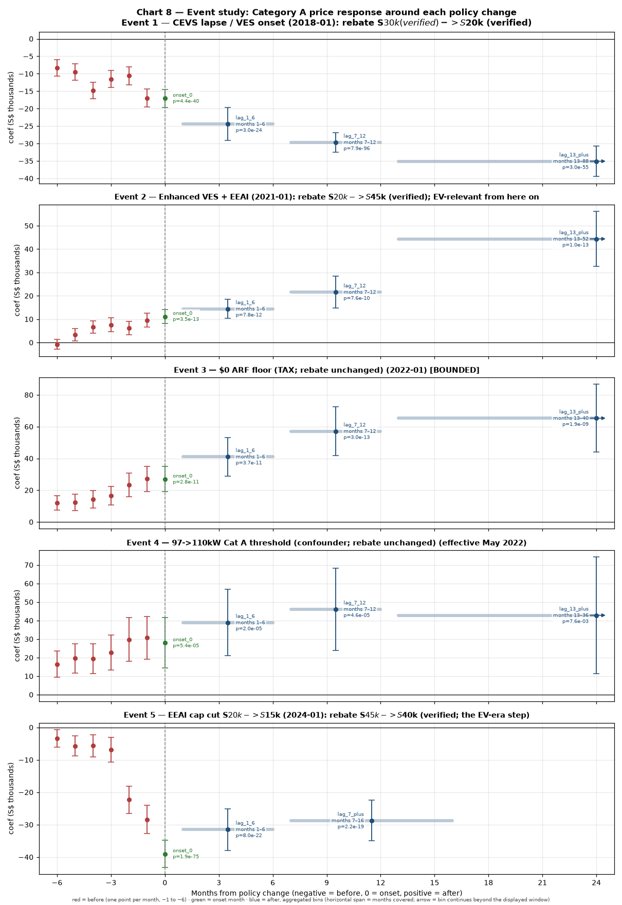

# Do electric car rebates make people bid more for COEs?
_Disclaimer: This analysis was prompted by a human, then carried out by an AI agent (Hermes + Qwen3.8-27B + [AIOS skillset](https://github.com/thongsia/aios)), and finally edited collaboratively between the two._

Singapore's EV rebates (VES, EEAI, and their predecessors) can save car
owners up to tens of thousands of dollars. A natural question: **do those
rebates push up the prices people pay to get a car-ownership quota (COE)?**
The idea would be that rebates make EVs cheaper to own, more people want
them, bidding demand rises, and COE prices go up.

This repo contains a data-driven study of exactly that question, using a full
decade of official COE auction results, car registration data, and the
verified real rebate policy timeline.

## The short answer

The honest result has two parts:

- **Over the whole decade (2016–2025): no detectable effect.** When the Jan
  2022 tax/threshold rules changed, car prices jumped — and the two
  categories where *no EV rebate exists at all* (C: goods vehicles & buses;
  D: motorcycles) did not confirm a rebate-specific cause: D jumped even
  more, C moved the other way (Figure 2). What changed in Jan 2022 was a tax
  rule (electric cars' minimum registration tax dropped to zero) plus a
  car-category power threshold — not a rebate step — so the jump can't be
  credited to the rebates.
- **In the EV era (2022–2025): a price reaction to the 2024 rebate cut.**
  When the government cut the maximum rebate from S$45k to S$40k in Jan 2024,
  the average EV-category COE price moved in the same direction as the
  rebates did — and categories without rebates did not show the same pattern.
  This is real, but small-sample and **associational**: it shows prices and
  rebates moved together, not that rebates *caused* the price change.

Bottom line: **we cannot find convincing evidence that EV rebates make
bidders bid more.** The study deliberately says "we can't detect it" rather
than pretending to measure a precise effect that the data can't support.

The full write-up, with all statistics, is in [`docs/REPORT.md`](docs/REPORT.md).

## The data

Three public, free datasets from [data.gov.sg](https://data.gov.sg):

| Data | What it tells us |
|---|---|
| COE bidding results (2010 → 2026) | Every auction's final price, how many people bid, and how many quotas were sold, by car category |
| Monthly car registrations (2016 → 2025) | How many electric vs hybrid vs petrol cars were registered each month |
| Consumer price index (monthly) | Inflation, so we can compare prices in "real" (inflation-adjusted) dollars |

Two data caveats worth knowing:

- **EV registration counts are lower bounds.** About half of the monthly
  registration rows don't carry a car-count number (the field went blank more
  often over time), so EV totals are reported with a monthly coverage rate.
- **Category A is not an "EV category."** It's the small-engine car
  category (engines up to 1600cc and power output up to 97kW / 130bhp;
  fully electric cars up to 110kW) — most EVs fit, which is why EVs land
  in it. That's why the study looks at the whole decade, not just
  "EV months".
- **The five categories (per LTA):** A: small cars (≤1600cc, ≤97kW; EVs
  ≤110kW). B: large cars (>1600cc or >97kW — i.e. high-power EVs land
  here). C: goods vehicles & buses. D: motorcycles. E: open — any vehicle
  except a motorcycle, so EV cars *can* bid here. Only C and D are truly
  free of EV rebates; B and E are "contaminated" (EVs can be in them),
  which is why the negative-control test (Figure 2) relies on C and D.

## What the rebate policy actually did

The analysis uses the **verified real policy timeline** (LTA/NEA
announcements and published rate sets):

| When | What happened | Max rebate available |
|---|---|---|
| 2016–2017 | CEVS (old clean-car scheme) still in force | ~S$20k (estimate) |
| Jan 2018 | CEVS ended; new VES scheme began | S$25k |
| Jan 2021 | New EEAI incentive launched on top of VES (45% off the registration tax, capped at S$20k) | S$45k total |
| Jan 2022 | Minimum tax on electric cars dropped to zero — EVs could now use the full rebate caps | S$45k (fully usable) |
| Jan 2024 | EEAI cap cut from S$20k to S$15k | S$40k total |

That's the key to the whole design: the rebate amount **changed four times**
over the decade, giving the statistics something to bite on. The full timeline
with sources is in `tables/rebate_timeline.csv`.

## What we found

### 1. The big 2022 price jump was not caused by the rebates

Category A prices rose about **20%** in early 2022 — roughly S$12,000
above the late-2021 level by Mar 2022, and still ~18% after adjusting for
inflation (Figure 1). The timing lines up with two rules that changed in
Jan 2022: electric cars stopped paying a minimum registration tax, and the
category's engine-power threshold was raised. The jump itself arrived in
Feb–Mar, rather than in the month of the changes.

**Figure 1.** Category A COE clearing price, 2016–2025, with the verified
policy changes marked.



*Top: nominal prices. Bottom: inflation-adjusted prices. Dotted gray lines
mark the verified policy changes; the dashed red line marks the Jan 2022
tax/threshold change.*

What the categories say: **of the two categories where no EV rebate ever
applies (C: goods vehicles & buses; D: motorcycles), only D moved like A —
in fact more — while C moved the other way** (Figure 2). That split means
the test can't cleanly rule out a market-wide shock, and it can't establish
an EV-specific cause either; the decisive facts are that the Jan 2022
change was a *tax rule* (the $0 ARF floor) co-timed with the 97→110kW
threshold, not a rebate dose step, and the estimated 2022-01 effect is not
statistically robust (p=0.064). (The "open" category E, where EV cars may
also bid, moved with the car categories — as expected.)

**Figure 2.** The negative-control test for the 2022 jump: estimated 2022-01
% price jump by car category, each measured over the full 2016–2025 window.



*The two rebate-free categories (C goods & buses, D motorcycles) split: D
(motorcycles) jumped more than A, C (goods) moved the other way — so the
jump is not a clean market-wide signal, but with the Jan 2022 change being a
tax rule, not a rebate step, it isn't credited to the EV rebate. B
(high-power EVs) and E (open; EV cars can bid) moved with the car
categories, as expected.*

*The price rise was also reported in the media. [The Straits Times](https://www.straitstimes.com/singapore/transport/coe-premiums-at-all-time-highs-in-2022-buyers-could-get-slight-reprieve-in-later-half-of-2023)
noted on 29 Dec 2022 that COE premiums went on "a relentless upward march
for much of 2022", setting all-time highs in four of the five categories,
driven by tight supply and strong demand. The
[LTA's official bidding results](https://www.lta.gov.sg/content/dam/ltagov/who_we_are/statistics_and_publications/statistics/pdf/M11-COE_Results_2020_2022.pdf)
show the same climb for Category A: the quota premium rose from S$57,898 in
Jan 2022 to S$71,556 in Mar 2022. Notably, the Straits Times piece also
speculated that the rebates and the new engine-power threshold rule may have
pushed up Category A prices — the very question this study tests.*

### 2. In the EV era, prices did respond to the 2024 rebate cut

Because the rebate changed *again* in Jan 2024 (S$45k → S$40k), the
2022–2025 window can be estimated on its own — the rebate amount varies
within it, so the statistics have something to work with. In that window:

- For every extra S$1,000 of maximum rebate, the average Category A price was
  about **S$4,100 higher** — a statistically clear association (p < 0.001 by
  several measures, nominal and inflation-adjusted alike).
- The rebate-free categories (C goods & buses, D motorcycles) did **not**
  show the same 2024 move (Figure 3), so this is plausibly EV-relevant
  (B and E are contaminated — EVs can bid in them — and moved with A).
- But the window has only 41 months and two rebate levels, so this is a
  **low-power association, not a measured causal effect**. It's evidence the
  price system responded to the rebate cut — not a number to quote as "how
  much rebates raise prices".

**Figure 3.** The negative-control test for the 2024 rebate cut: estimated
2024-01 % price jump by car category (the rebate cut shows up as a price
drop), each measured over the 2022–2025 window.



*The 2024 cap cut drops prices in the EV-eligible car channels (A, B, and the
open category E, where EV cars can bid) by ~23–37%, while the two rebate-free
categories (C goods, D motorcycles) move only ~7–8%.*

### 3. Rebates did not make more people bid

If the rebate story were true, we'd expect bidding demand in Category A to
rise with rebate generosity. It didn't: the bidding numbers show no
consistent, same-direction link to the rebate changes (in the EV era the
statistical sign is even backwards, which is most consistent with noise and
mixing in non-EV demand — Category A is still mostly non-EV cars). Figures 4
and 5 show the price-vs-bids relationship and the EV uptake directly.

**Figure 4.** Category A COE price (left axis) vs number of bids received
(right axis), over the full 2016-01..2025-05 window.


*Price and bidding demand over the full window — note how weakly connected
the two are. The bids series is a corrected one (the official column was
missing for 19 months); the shaded area is the 2022-01..2023-12 era when
the full S$45k rebate was in force, and the dashed line marks the Jan 2024
cut to S$40k.*

**Figure 5.** Electric car registrations and their share of new-car sales,
with the data-coverage lower bound.



*Electric car registrations and their share of new-car registrations from
2022-07 (when the official EV label first appears); bars are a lower bound
because some months have no count. The dashed line marks the Jan 2024 cut
of the maximum rebate from S$45k to S$40k.*

### 4. Prices and bidding demand barely track each other

A basic requirement for "more bidding → higher prices" is that price and
bids actually move together. Across the decade they mostly don't (Figure 6).

**Figure 6.** Each dot is a month: Category A price vs bids received, with
the best-fit line and its uncertainty band.



*The fit line is nearly flat — more bids did not reliably mean higher prices.*

### 5. The "rebate → more bidders → higher price" chain is broken

We also decomposed the effect the way the hypothesis describes: rebate →
bidding demand → price. The middle link (rebate affecting bidding) is null,
so the whole chain is null — **whatever small price movement exists is not
routed through more bidding** (Figure 7).

**Figure 7.** The hypothesized chain — rebate → bidding demand → price —
with the estimated size of each step for both time windows.



*The indirect (via-bidding) path is statistically indistinguishable from
zero in both time windows.*

### 6. Looking at each policy change individually doesn't help either

An "event study" examines prices around each of the four policy changes.
Every single one shows the price was already drifting in that direction
*before* the policy started (Figure 8) — the signature of the long-run COE
price trend (plus the pandemic-era dip in 2020), not of the policy itself.
The estimated effects are therefore reported as bounds, not point estimates.

**Figure 8.** Estimated price changes around each of the four policy
changes, with uncertainty bars.



*One panel per policy change (2018 VES, 2021 EEAI, 2022 tax floor, 2024 cap
cut). The left side of each panel (months *before* the change) already shows
large non-zero moves — the pre-trend problem.*

### 7. What we can and can't claim

- **Can claim:** no detectable EV-specific effect of the rebates on COE
  prices or bidding across the decade; the 2022 price jump showed up in
  categories without EV rebates too (market-wide);
  prices and bidding demand are weakly related; the via-bidding chain is
  broken.
- **Can't claim:** a precise "rebates raise prices by X" number. The rebate
  policy was itself *set in response to* EV demand (policy and outcome move
  together by construction), the samples are small, and the one detected
  association sits in a 41-month window with two rebate levels.

## Under the hood (for the curious)

**How the study works.** The design's core trick: rebates changed level four
times over 2016–2025, so months can be compared across rebate levels.
Everything is estimated on the full decade (110 months with auctions), and
the 2022–2025 "EV era" is estimated separately too, because the rebate amount
changes *within* that window (the 2024 cap cut). A guard module checks this
programmatically before any result is
produced (`src/05_scope_guard.py`).

**Reproducibility.** Every number in the report traces to a file: raw data in
`data/raw/` (with a provenance record tying each download to its source),
processed panels in `data/processed/`, one CSV per table in `tables/`
(27 CSVs), eight charts in `charts/` (Figures 1–8), and the reports in `docs/`. A
verification module re-checks row counts, citations, and that all 112 report
figures match the tables (the current run passes 9/9 checks).

**Re-running it.**

```bash
python3 -m pip install pandas statsmodels matplotlib
cd <repo root>
python3 src/01_fetch.py         # re-download the three data.gov.sg stores (fails on count mismatch)
python3 src/05_scope_guard.py   # build the panel, run all exhibits, audit the scope rules
python3 src/13_charts.py        # regenerate the charts
python3 src/14_verify.py        # re-run the 9 verification checks
python3 src/15_report.py        # regenerate both reports from the tables
```

**Repository layout.**

```
README.md                  ← this file
docs/REPORT.md             ← full report
docs/STATS_SUMMARY.md      ← one-page statistics summary
data/raw/                  ← source CSVs + provenance.csv
data/processed/            ← monthly panels
tables/                    ← one CSV per reported table
charts/                    ← the eight charts shown above (Figures 1–8)
src/                       ← 18 ordered Python modules (fetch → panel → exhibits → verify → report)
```

---

*Analysis window: 2016-01 → 2025-05 (with COE-only descriptive extension to
2026-10). Built with the KAKIS research→plan→synthesize→execute pipeline.
All figures in the reports trace to `tables/*.csv`.*
