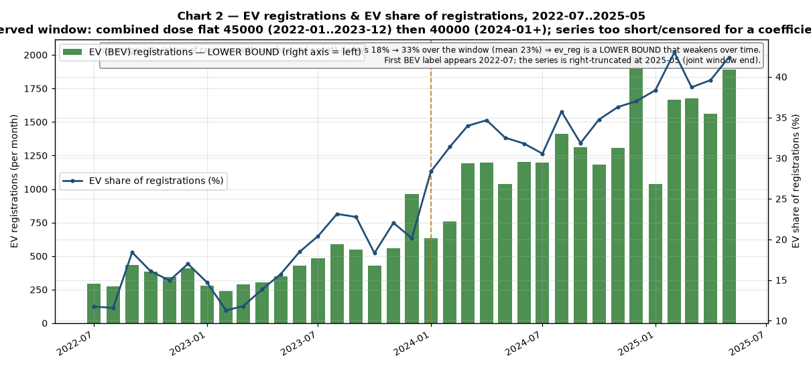
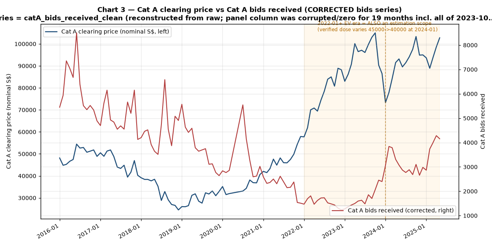
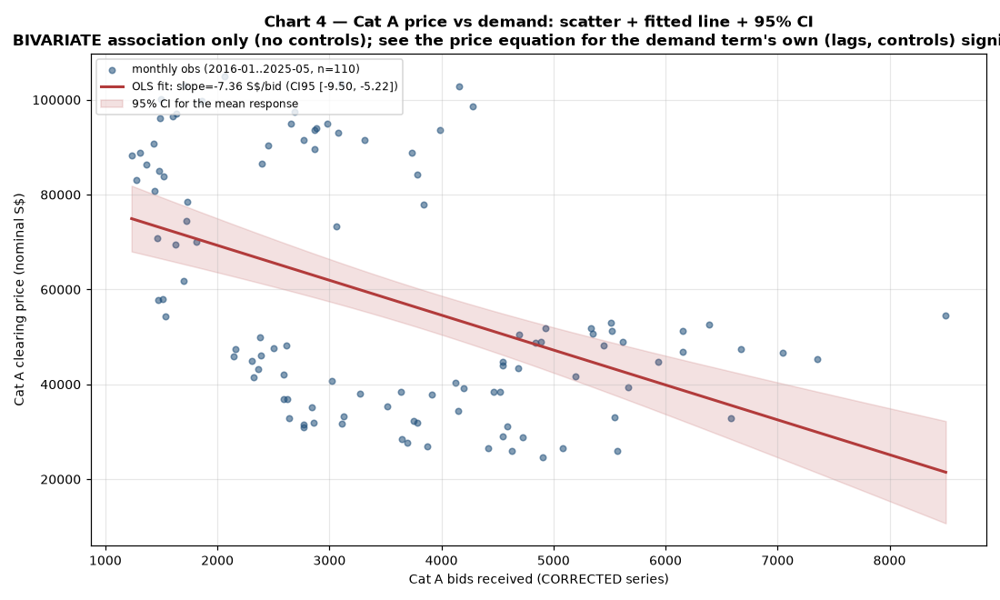
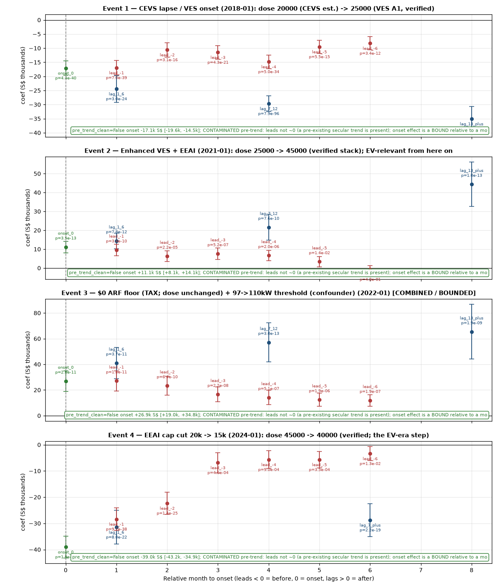

# Do EV rebates make COE bidders bid more?

An empirical analysis of whether Singapore's EV rebate system affects **COE
(Certificate of Entitlement) bidding prices and final clearing prices** —
specifically, whether the *offer* of a rebate causes bidders to bid more.
EV rebates are used as the case study.

> **Bottom line (honest):** The EV rebate offer does **not** detectably cause
> bidders to bid more, or raise Category A COE clearing prices, *through an
> EV-specific channel*. The 2022-01 price jump in Category A fails the negative-control test —
> rebate-free categories C/D/E show the same jump — pointing to a
> market-wide common shock rather than a rebate effect. Every causal link
> in the study grades **not detectable**; the evidence is associational at
> best, given endogeneity and low statistical power. See
> [`docs/REPORT.md`](docs/REPORT.md) for the full report.

---

## 1. Study objectives

1. **Primary question:** Does the offer of an EV rebate cause people to bid
   more in the COE auction (i.e. raise Category A bidding demand and the
   clearing price)?
2. **Mechanism under test (indirect channel):** EV rebates (VES/CEVS/EEAI,
   incl. the 45%-of-ARF rebate) lower the *total cost of owning an EV*, not
   the COE premium directly. The hypothesized path is:

   ```
   rebate → lower EV cost → more EV demand → higher Cat A COE demand → higher clearing price
   ```

   The analysis tests each link of this chain and decomposes the total effect
   into the indirect (mediated) path vs. a residual direct path.
3. **Counterfactual discipline:** Because rebates have been continuously in
   place (with gradual changes) rather than a clean on/off switch, the design
   must separate any rebate effect from confounders that move COE prices
   independently — most importantly the Jan 2022 Category A power-threshold
   change (97 → 110 kW), the 2026 PARF cuts, and the 2026 COE supply trough.

## 2. Study design

### 2.1 Data & panel

- **Joint analysis window: 2016-01 → 2025-05** (113 months; 110 with COE
  exercises — 2020-04/05/06 were suspended, documented and listwise-dropped).
  Registrations end 2025-05, so 2025-06 → 2026-10 is a **COE-only descriptive
  extension**, excluded from all joint models.
- COE exercises run **1–2 per month**, so a single documented collapsing rule
  is applied: *mean* clearing price across a month's exercises per category;
  *sum* of bids and quota; an `exercise_count` audit column whose per-category
  sums must reconcile exactly to raw row counts (they do: 220 per category in
  the window).

### 2.2 The estimable-scope rule

The verified real-policy rebate timeline has **4 distinct dose levels** across the
full window:

| Period | Dose (S$) | Policy change |
|---|---|---|
| 2016-01 → 2017-12 | 20,000 | CEVS pre-VES baseline (flagged as estimate) |
| 2018-01 → 2020-12 | 25,000 | VES Band A1 onset |
| 2021-01 → 2023-12 | 45,000 | VES A1 + EEAI stack |
| 2024-01 → 2025-05 | 40,000 | EEAI cap cut ($20k → $15k) |

This means:

- Every rebate-intensity exhibit (price equation, bidding channel, mediation)
  is **estimated on the full joint window** — the only scope where the rebate
  dose spans multiple levels.
- The **2022+ EV era** (2022-01 → 2025-05) is now also a **valid estimation scope**
  because the dose varies within it (45,000 → 40,000 at 2024-01). It was
  previously rank-deficient under the old schedule. Reported as both an
  estimation scope and an *interpretation* scope (the EV-relevant era).
- The scope rule is enforced *programmatically* by `src/05_scope_guard.py`
  (assertions logged to `tables/scope_audit.csv`) and re-verified
  by `src/14_verify.py`.

### 2.3 Causal exhibits

| Exhibit | Specification | Estimation scope | Chart(s) |
|---|---|---|---|
| **Price equation** | Cat A clearing price (nominal + real) on lagged (t-1, t-2) Cat A bids received, rebate regime dummies + continuous dose (separate specs), quota, time trend, CPI, confounder dummies; OLS with robust (HC1) and HAC (Newey-West) SEs | full window; 2022+ EV era | [`Chart 1`](charts/01_price_regime.png) |
| **Bidding channel** | Cat A bids received on rebate intensity + trend + quota + confounders; cross-lag check (lag ±1) | full window; 2022+ EV era | [`Chart 2`](charts/02_ev_demand.png), [`Chart 3`](charts/03_price_demand_dual.png) |
| **Registration channel** | EV registrations + EV share + coverage rate (descriptive/correlational only — no within-window rebate variation) | 2022-07 → 2025-05 | [`Chart 2`](charts/02_ev_demand.png) |
| **Mediation** | rebate → bids → price decomposed into indirect + direct paths; 2-stage bootstrap CIs (2000 resamples); mediated (indirect/total) share | full window; 2022+ EV era | [`Chart 6`](charts/06_mediation_diagram.png) |
| **Event study** | Coefficients + CIs around each regime change (2018-01 VES, 2021-01 EEAI, 2022-01 zero-ARF-floor, 2024-01 cap cut); pre-trends checked | per event | [`Chart 5`](charts/05_event_study.png) |
| **Negative controls** | Price/demand re-estimated on Categories C, D, E (no EV rebate — clean controls) and B (contaminated upper bound) | full window; 2022+ EV era | [`Chart 1`](charts/01_price_regime.png) |
| **Evidence grading** | Each link graded *supported / directionally consistent / not detectable*; low-power and endogeneity caveats restated; precise magnitude claims forbidden | per link | — |
| **Scatter / fit** | Price-vs-demand scatter with OLS fit and 95% CI band | full window; 2022+ EV era | [`Chart 4`](charts/04_scatter_fit_ci.png) |

### 2.4 Data-flow/layering contract

The pipeline is strictly ordered and re-runnable: each numbered module reads
only from `data/raw` or earlier `data/processed` files and writes only to
`data/processed` or the output directories. A single pinned provenance record
(`data/raw/provenance.csv`) ties every fetched row count to its stated source
total, so **every number in the report traces to a concrete upstream file**
(112/112 report figures verified — `tables/report_figures_checklist.csv`).

## 3. Datasets

All three stores are public on
[data.gov.sg](https://data.gov.sg), auth-free. Raw CSVs and pinned provenance
are in [`data/raw/`](data/raw/) (`provenance.csv` records resource id,
retrieval timestamp, stated total, and fetched count — all reconciled `OK`).

| Store | Resource ID | Rows | Coverage | Notes |
|---|---|---|---|---|
| COE bidding results | `d_69b3380ad7e51aff3a7dcc84eba52b8a` | 1,985 | 2010-01 → 2026-10 | one row per (month, category A–E, exercise); clearing premium, quota, bids received/successful. **Category E is the motorcycle category**, not an EV category. |
| Monthly new-car registrations | `d_d3f4d708e1d0a37b4365414e2fad3a07` | 51,669 | 2016-01 → 2025-05 | by make/fuel/vehicle type. The `Electric` (BEV) label first appears **2022-07**; `Petrol-Electric` hybrids kept separate. The count field is null on ~57% of rows (rising over time), so EV totals are **lower bounds** reported with a monthly coverage rate. |
| CPI All Items (2024 base) | `d_bdaff844e3ef89d39fceb962ff8f0791` | 207 | monthly | deflates the Cat A clearing price to real terms (an annual-inflation fallback was considered and rejected because monthly CPI is available). |

### Verified real-policy rebate timeline

The in-window regime changes encoded as step dummies + a continuous dose are
documented in `tables/rebate_timeline.csv` with per-change citations to LTA/NEA
sources and coewatch.sg. The verified timeline:

| Date | Policy change | Dose effect | Source |
|---|---|---|---|
| 2016-01 | CEVS (revised) in force; Band A1 ≈ $20k (estimated) | baseline 20k | onemotoring.lta.gov.sg; motorist.sg |
| 2018-01 | CEVS lapses; VES Band A1 $25k begins | 20k → 25k | NEA joint release 12 Nov 2020 |
| 2021-01 | Enhanced VES maintained + EEAI introduced (45% ARF, cap $20k) | 25k → 45k (stacked) | NEA/LTA joint release; coewatch.sg |
| 2022-01 | Zero ARF floor for EVs begins (tax provision, not a rebate) | full 45k caps usable | Straits Times Budget 2021; coewatch |
| 2024-01 | EEAI cap $20k → $15k | 45k → 40k | LTA circulars via coewatch.sg |

**Caveats:** CEVS pre-2018 dose is an estimate (direction certain, magnitude
approximate). The 45k stacked dose assumes the full EEAI + VES cap is realized
for EVs in Category A (in practice, the cap is a maximum, not an average). The
2022-01 zero ARF floor is a tax provision, not a rebate, and is a confounder
for the rebate→price coefficient.

## 4. Analysis

An 18-module Python pipeline (`src/`, pandas + statsmodels + matplotlib) runs
in strict order and is fully re-runnable:

```
00_data → 01_fetch → 02_coe_panel → 03_registrations → 04_panel_rebate   (data + panel)
05_scope_guard                                                          (enforces scope rules)
06_price_equation → 07_demand_bidding → 08_demand_registration          (causal exhibits)
09_mediation → 10_event_study → 11_diagnostics → 12_grading             (mechanism + robustness)
13_charts → 14_verify → 15_report                                       (outputs)
```

Outputs: processed panels in `data/processed/`, one CSV per reported table in
`tables/` (27 tables incl. per-chart data tables), six charts in `charts/`,
and the two reports in `docs/`. `14_verify.py` re-runs 9 reconciliation checks
(row-count, audit-sum, source-citation, figure-traceability, scope) — the run
in this repo scored **PASS 9/9**.

### How to re-run

```bash
python3 -m pip install pandas statsmodels matplotlib
# from the repo root:
python3 src/00_data.py        # bootstrap environment
python3 src/01_fetch.py       # re-fetches all three stores (hard-fails on count mismatch)
python3 src/04_panel_rebate.py # re-encode panel with verified policy dose
python3 src/05_scope_guard.py # runs modules 06–12 in order, then audits scope
python3 src/13_charts.py
python3 src/14_verify.py
python3 src/15_report.py
```

## 5. Key insights (verified-policy re-run)

1. **The 2022-01 price jump is a market-wide common shock.** The full-window
   price equation shows a 2022-01 ARF-floor dummy of **+S$3,826** (p=0.064,
   CI [−228, 7,879]). But rebate-free **Categories C/D/E show the same 2022-01
   jump** (C +13.7%, D +41.8%, E +36.4% vs A's +10.1% — full-window NC pass,
   but the effect is not EV-specific). The increase is best read as a
   **market-wide common shock** co-timed with the 97→110 kW threshold change —
   **not an EV-rebate-specific effect**. See [`Chart 1`](charts/01_price_regime.png).

2. **The 2024-01 dose step is detected in the 2022+ EV era (but low-power).**
   In the 2022+ estimation scope (41 obs, 2 dose levels), the rebate→price
   coefficient is **+S$4,113 per S$1,000 dose** (p=4.5e-5; dummy: −S$20,564,
   p=4.5e-5). The negative-control check at 2024-01 does **not falsify** the
   effect (A −23.0% vs C −7.9%, D −7.4%, E −36.1%). However, this is a
   low-power association (41 obs, 2 dose levels), not a clean causal magnitude.
   See [`Chart 1`](charts/01_price_regime.png).

3. **The rebate does not detectably raise bidding demand.** Cat A bids received
   show a **−S$111.5** coefficient per S$1,000 dose in the 2022+ scope
   (p=0.005) — the opposite sign from what a causal rebate channel would
   predict. In the full window, the 2024-01 step dummy is +680 bids (p=0.004)
   but the dose term is null (p=0.29). Total Category A demand is dominated
   by non-EV cars; its EV-signal is material only from ~2022. See
   [`Chart 2`](charts/02_ev_demand.png), [`Chart 3`](charts/03_price_demand_dual.png).

4. **The indirect (mediated) path is null.** The rebate→bidding→price indirect
   effect is −9.0 (CI spans 0) in the full window and −331.8 (CI spans 0)
   in the 2022+ EV era; the mediated share is −0.016 and −0.115 respectively.
   Whatever price effect exists is **not routed through Category A bidding
   demand**. See [`Chart 6`](charts/06_mediation_diagram.png).

5. **All causal links grade *not detectable*.**
   - rebate→price (full window): not detectable (2022-01 confounded)
   - rebate→price (2022+ EV era): detected but low-power, not causal
   - rebate→demand bidding: not detectable (wrong sign in 2022+)
   - demand→price: not detectable in both scopes
   - mediation (indirect effect): not detectable in both scopes
   See [`Chart 4`](charts/04_scatter_fit_ci.png) for the price-demand relationship.

6. **Event study: all four onsets have contaminated pre-trends.**
   Onset effects: 2018-01 −S$17,068 / 2021-01 +S$11,145 /
   2022-01 +S$26,922 / 2024-01 −S$39,017. All exhibit significant
   pre-trends (leads), so effects are reported as bounds only. See
   [`Chart 5`](charts/05_event_study.png).

7. **Honest framing.** With only 4 effective treatment changes and ~110 monthly
   observations, power is low and the rebate policy is endogenous (set in
   response to EV demand; registrations depend on the COE price paid). The
   study therefore **declines to claim a precise causal magnitude** — its
   defensible conclusion is the *absence* of detectable EV-specific evidence,
   not a quantified effect size.

## 6. Repository layout

```
├── README.md                  ← this file
├── docs/
│   ├── REPORT.md              ← full written report (exec summary, data, results, limitations)
│   └── STATS_SUMMARY.md       ← one-page statistical summary
├── data/
│   ├── raw/                   ← verbatim source CSVs + provenance.csv
│   └── processed/             ← coe_monthly, ev_registrations, cpi_deflated, panel_joint, COE extension
├── tables/                    ← one CSV per reported table (incl. per-chart data tables)
├── charts/                    ← 01–06 PNGs (price+regime w/ negative-control panel, EV demand,
│                                │   price-vs-demand dual, scatter+CI, event study, mediation diagram)
├── src/                       ← 18 re-runnable pipeline modules (00_data … 15_report)
└── .gitignore
```

### Charts

**Chart 1 — Price, regimes, and the negative-control test**


*Nominal + real Cat A price with regime/confounder markers **and the
negative-control comparison** — the 2022-01 market-wide jump (all categories)
and the 2024-01 dose step in the EV era.*

**Chart 2 — EV demand**



*EV registrations + share with coverage lower-bound — the 2022-07 EV-label
onset and subsequent uptake.*

**Chart 3 — Price vs demand**



*Dual-axis price vs bids — the divergent trajectories post-2022.*

**Chart 4 — Price-demand relationship**



*Price-vs-demand scatter with fit + CI band — illustrates the null
demand→price link.*

**Chart 5 — Event study**



*Event-study coefficients with CIs for all four verified-policy onsets
(2018-01, 2021-01, 2022-01, 2024-01) — contaminated pre-trends reported as
bounds.*

**Chart 6 — Mediation**


*Mediation path (rebate → bidding demand → price) with effect sizes for both
the full window and the 2022+ EV era — the indirect effect is null in both.*

---

*Analysis window 2016-01 → 2025-05 (joint) + 2025-06 → 2026-10 (COE-only
extension). Re-run against verified real-policy rebate timeline (EEAI/VES/zero-ARF-floor) with dual estimation scopes: full window (109 obs, 4 dose levels) and 2022+ EV era (41 obs, 2 dose levels). Generated by the KAKIS research→plan→synthesize→execute pipeline
(Igor feasibility → Dory iterative planning, 6 iterations → Bob best-of-breed
synthesis → 3 sequential execution batches). All figures trace to `tables/*.csv`.*
